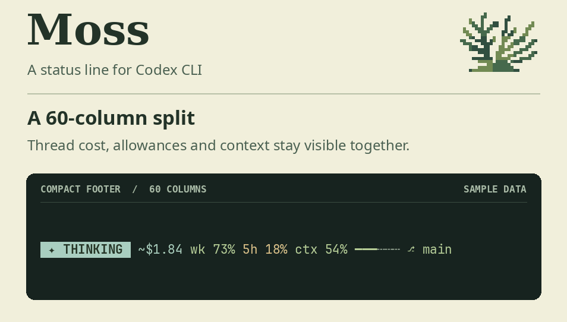

# Moss for Codex

A terminal footer for keeping an eye on your weekly allowance, your five-hour allowance, and the context left in the current thread. Moss puts the weekly balance beside the activity indicator. When the five-hour balance drops to 25%, it moves up front too.



## Try it before installing

From an extracted copy or clone of this repository, run the split-terminal demo.

```sh
python3 demo.py --scene split
```

Run `python3 demo.py` for all four examples. The demo uses fictional snapshots and works offline. On Windows, use `python` in place of `python3`. The footer and demo use the Python 3.9+ standard library. Git is optional. Use Git 2.36 or later for worktree details.

## Connect it to Codex

Run these commands **from the repository directory on the machine running the Codex app server**. Keep the directory in place so Codex can start the provider again. Tested with Codex CLI 0.172.0 on Linux.

**macOS or Linux**

```sh
codex features enable tui_extensions_statusline
codex mcp add moss -- "$(command -v python3)" -u "$PWD/statusline.py"
```

**Windows PowerShell**

```powershell
$python = python -c "import sys; print(sys.executable)"
$provider = (Resolve-Path .\statusline.py).Path
codex features enable tui_extensions_statusline
codex mcp add moss -- $python -u $provider
```

Restart the Codex TUI, open a fresh conversation and enter `/statusline`. Under **Choose a status line provider**, select **Moss · compact** for split panes or **Moss footer** for the full view. You can switch between them in the same picker.

## Reading the footer

| Field | What it tells you |
| --- | --- |
| Activity | Whether the displayed thread is ready, starting, thinking, working or waiting. |
| Week / 5h | Percentage of the allowance **remaining**. Amber starts at 25%, red at 10%. A dash means Codex hasn’t supplied the weekly window. The full view shows the weekly reset countdown and, when the five-hour balance is low, its countdown too. |
| Context | Percentage of the current thread’s context window remaining. The full view adds a six-segment meter. Appears when Codex reports usage. |
| Git | Branch or detached commit, plus commits ahead ↑ and behind ↓ the locally recorded upstream. Counts show staged, edited, new and conflicted entries. In compact mode these are `+`, `~`, `?` and `!`. |
| Workspace and model | Full mode shows the directory, model, reasoning level and service tier when available. Compact mode shows the branch, or the directory name outside a repo. |

The demo wraps fields so you can inspect them all. Codex may clip the right edge in a narrow terminal. Compact mode keeps balances near the left and drops the model and countdowns.

## What runs locally

Codex sends the displayed thread’s snapshot to a small Python process over standard input. Moss reads the account windows from that snapshot. It doesn’t request an API key or store a usage history.

For Git details, Moss checks the thread’s working directory and caches the result for five seconds. It skips submodule changes, uses the locally recorded upstream, and falls back to the branch when a status scan takes too long or Git has a configured clean or process filter. A staged file edited again can count in both columns.

## Troubleshooting and removal

- **Moss is missing from the picker.** Run `codex mcp get moss` on the app-server host and check the interpreter and script paths. Verify **Custom status line** in `/experimental`, restart the TUI and open a fresh conversation.
- **The footer falls back during a session.** Press F2 for the failed read. After fixing the provider, restart its process and select it again in `/statusline`.
- **Remove Moss.** Select **Default status line** in the picker, then run `codex mcp remove moss`.

Run `python3 -m unittest discover -s tests -v` to exercise the MCP interface and Git behavior. The project uses the [MIT license](LICENSE).
